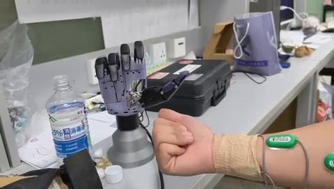
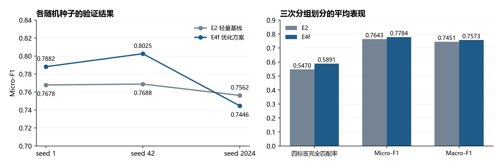

# 基于肌电运动意图识别的仿生假肢手

面向仿生假肢手的运动意图识别与个体化控制，开展文献方法研究、开源算法复现、模型优化、实验范式设计、数据质量分析及软硬件系统联调。

## 真机验证

采集本人肌电信号后，完成个体化模型训练，并将模型加载至机械手开展在线动作验证。

[观看完整视频](media/current-debug-demo.mp4)

## 本人主要工作

- **方法研究与算法复现**：研究肌肉协同、仿生控制及抓握分类方法；拆解 CNN/CNN-LSTM 肌电识别流程，完成 MATLAB 运行适配、CNN 模型训练及小规模测试。
- **模型优化与实验分析**：基于既有 CNN-Transformer 框架，完善文件级分组验证、稳健归一化、类别加权损失与逐标签阈值搜索，通过多阶段消融及多随机种子实验筛选优化方案。
- **实验范式与软件开发**：参与细化单标签分类与协同解码的公平对照，开发校准提示、约束任务调度、实验状态管理、标注训练衔接及事件记录模块。
- **数据处理与硬件联调**：开展肌电与手套记录的完整性、因果特征及标签有效性分析；实现实时采集、可视化、串口解析与并发记录，推进 STM32、RS-485 及 DMA 遥测链路调试，完成本人肌电训练模型驱动机械手的初步在线验证。

## 代表性离线结果

单受试者、文件级分组验证，以下为三个随机种子的平均结果。E2 为本地轻量基线，E4f 为优化候选方案。

| 评价指标 | E2 | E4f |
| :--- | ---: | ---: |
| 四标签完全匹配率 | 54.70% | **58.91%** |
| Micro-F1 | 0.7643 | **0.7784** |
| Macro-F1 | 0.7451 | **0.7573** |
| Hamming Loss ↓ | 0.1199 | **0.1139** |

四标签完全匹配率平均提高 **4.21 个百分点**。阈值在验证集选定；离线评估与真机视频分别对应各自的实验设置。

## 项目资料

- [研究与工程工作](docs/contributions.md)
- [实验范式与软件实现](docs/experiment-and-engineering.md)
- [离线评估与汇总数据](docs/results.md)
- [真机验证说明](docs/demo.md)
- [文献与复现来源](docs/references.md)

项目基于研究组已有框架与硬件开展。仓库展示个人承担的研究及工程工作，项目源码保密。
