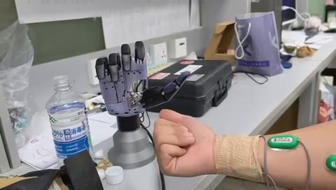

# 模型驱动机械手动作验证

[观看完整视频](../media/current-debug-demo.mp4)

## 验证流程

采集本人肌电信号，完成个体化模型训练，将模型加载至机械手，并开展在线动作验证。视频记录该次训练后模型驱动样机的动作表现。

## 验证范围

本次验证体现了个体肌电数据采集、模型训练、模型加载与真机执行的衔接。六月离线评估与本次视频分别对应各自实验设置，量化指标见[离线评估结果](results.md)。
