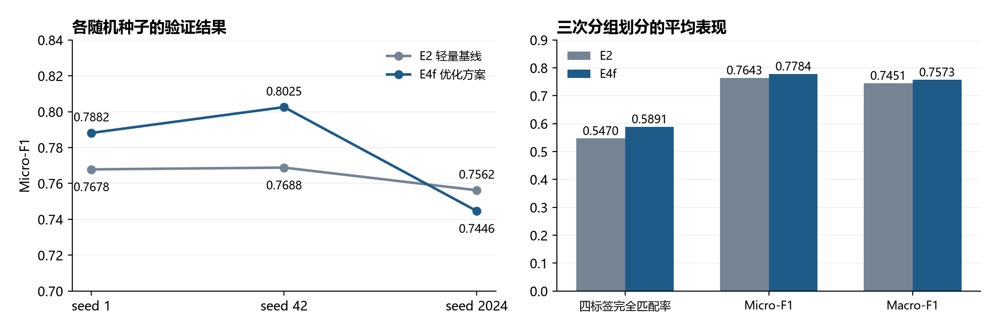

# 离线评估结果

## 评估范围

使用单名受试者的数据，按受试者文件分组，使同一文件的重叠窗口不跨训练与验证。训练20轮，窗口30点、步长10点；比较E2轻量参考与E4f优化候选，保存seed 1、42、2024的结果。

阈值在同一验证集搜索，因此结果用于阶段性方法筛选，不作为独立测试集结论。随机种子同时影响初始化与分组，不能将其解释成单纯的初始化稳定性实验。

## 主要观察

三次平均四标签完全匹配率从0.5470提高至0.5891，Micro-F1从0.7643提高至0.7784，Macro-F1从0.7451提高至0.7573，Hamming Loss从0.1199降至0.1139。

seed 42的E4f Micro-F1为0.8025、Macro-F1为0.8144。seed 2024的Micro-F1出现回落，图和CSV保留这一结果。

[查看八条汇总记录](../results/offline_metrics.csv)

## 与真机验证的关系

早期离线模型使用8通道输入；真机视频展示采集本人肌电、现场训练并加载模型后的动作验证。视频和离线结果分别对应各自的模型与设备设置。完全匹配率要求四标签同时正确，Hamming Loss表示平均标签错误率，两者不能混称“手势准确率”。
